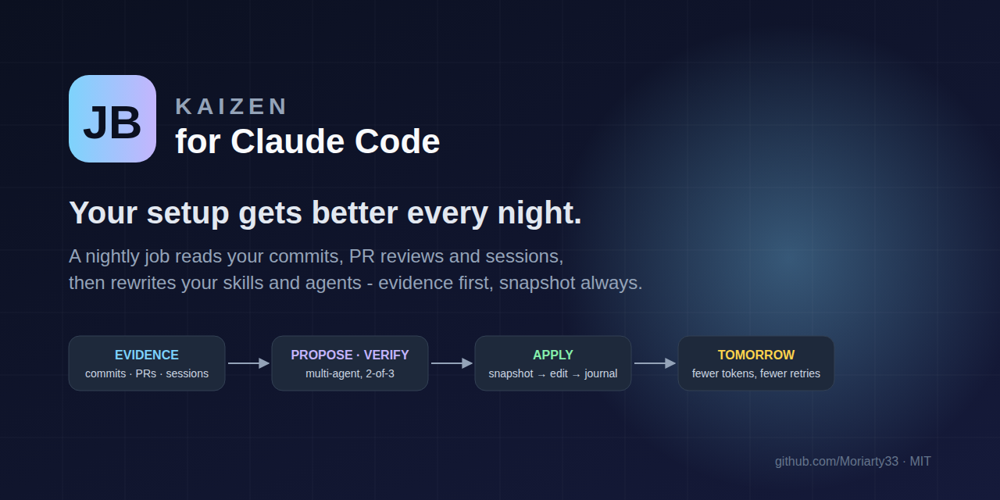
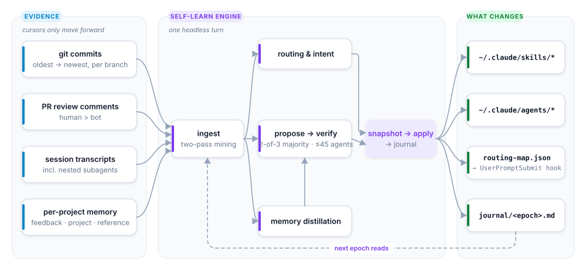
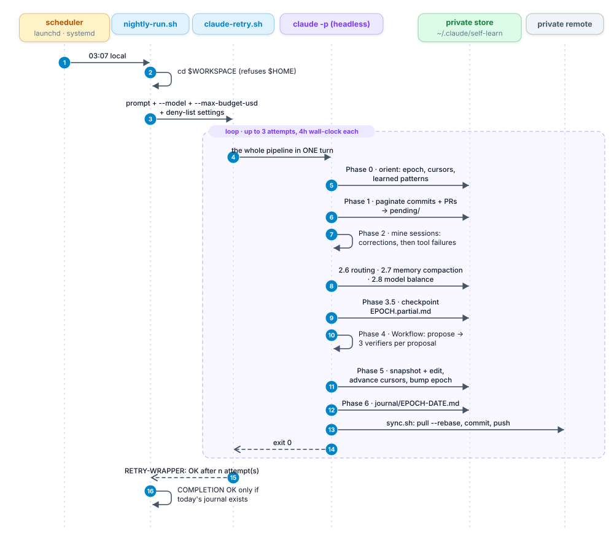
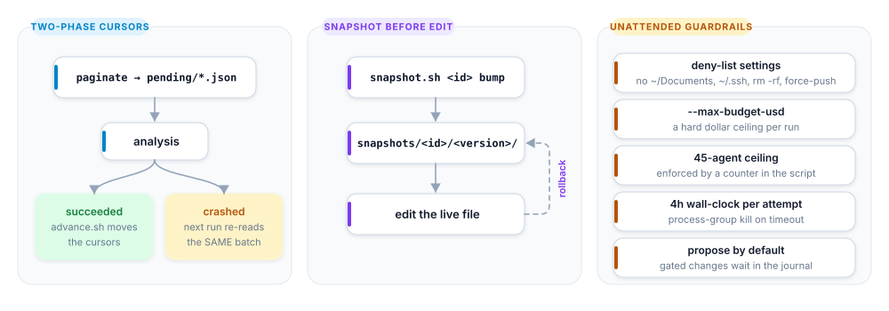
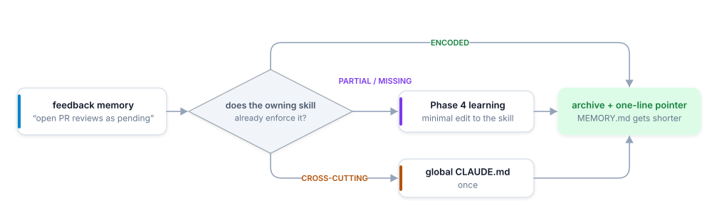

<p align="center">
  
</p>

<h1 align="center">JB Kaizen for Claude Code</h1>

<p align="center">
  <b>A nightly job that reads what you and Claude actually did today, then rewrites your skills and agents so tomorrow costs fewer tokens, fewer retries and less of your attention.</b>
</p>

<p align="center">
  <a href="#install"></a>
  <a href="LICENSE"></a>
  
  <a href="README.uk.md"></a>
</p>

<p align="center"><sub><b>Sponsored by <a href="https://hoply.work">Hoply</a></b> - it gathers your week from Google Calendar, GitHub, Jira and Harvest, so you approve your hours instead of typing them.</sub></p>

---

Claude Code gets its behaviour from files you own: `~/.claude/skills/*/SKILL.md`, `~/.claude/agents/*.md`,
`CLAUDE.md`, per-project memory. They only get better when you sit down and edit them - which is exactly the
kind of chore that never happens. **JB Kaizen** turns that chore into a loop:

1. **Every night** a scheduled `claude -p` run wakes up, reads the *new* evidence since last time - git commits,
   PR review comments, session transcripts, per-project memories - never re-reading history it already processed.
2. It **mines** that evidence for what went wrong mechanically (tool calls that failed and were silently worked
   around), what you corrected, what reviewers keep flagging, and which skill you *meant* but Claude did not pick.
3. A **multi-agent propose → adversarially-verify** workflow turns findings into minimal, evidence-cited edits.
   Every edit needs a 2-of-3 verifier majority; anything that trades quality for speed is rejected.
4. Each surviving edit is **snapshotted, versioned and applied**, and a journal entry explains what changed and why.
   Rolling back is one command.

Run it for a month and the compounding is visible: the reviewer stops missing the same class of bug, the
routing hook sends "check in logs why it happened" to the right skill on the first try, the tokens per task go
down, and you spend the morning on work instead of on re-explaining yourself.

> Extracted from a private setup that ran this loop for **66 consecutive epochs** (June - September 2026) over
> ~70 repositories. Everything project-specific was stripped; every hard-won engine rule stayed.

## How it works

<picture>
  <source media="(prefers-color-scheme: dark)" srcset="docs/assets/diagrams/how-it-works.en.dark.svg">
  
</picture>

### The nightly run, end to end

<picture>
  <source media="(prefers-color-scheme: dark)" srcset="docs/assets/diagrams/nightly-run.en.dark.svg">
  
</picture>

### Why it is safe to leave running

<picture>
  <source media="(prefers-color-scheme: dark)" srcset="docs/assets/diagrams/guarantees.dark.svg">
  
</picture>

- **Evidence or it doesn't ship.** Every edit cites the commit, PR comment or session line that motivates it.
- **Reversible always.** `snapshots/<id>/<version>/` is the source of truth; `/self-learn rollback <id> <version>` restores it.
- **Non-destructive by default.** `/self-learn` proposes; `/self-learn apply` (or the nightly prompt) applies.
- **Lean.** Metadata into context, full diffs and transcripts to `/tmp` and `grep`. The tool that hunts token waste
  is not itself a token sink.

### The feedback → skill loop (Phase 2.7)

Per-project memory is the highest-signal input and the most expensive one: `MEMORY.md` loads into *every* session.
Kaizen treats each feedback memory as a bug report against a skill:

<picture>
  <source media="(prefers-color-scheme: dark)" srcset="docs/assets/diagrams/feedback-loop.dark.svg">
  
</picture>

Either the skill learns the rule, or the memory proves the skill already knows it. Either way it stops being
loaded verbatim forever.

## Install

Requirements: [Claude Code](https://code.claude.com/docs/en/setup) (`claude` on `PATH`), `git`, `jq`, `python3`.
Optional: GitHub CLI `gh` (authenticated) for PR-review mining, `npx ccusage` for the model-balance phase.

### One line

```bash
npx -y jb-kaizen
```

Needs Node 18+. It asks two things only:

1. **Install the recommended set? [Y/n]** - Y adds the Claude Code plugin with every skill, nightly learning at
   03:07, the routing hook, the `/kz-*` aliases and the workday Hoply reminder. n: type the skills you want,
   comma separated (`hoply-day, commit`), and you get exactly those as personal skills.
2. **Connect Hoply? [Y/n]** - Y opens your browser to sign in with your Hoply account, then brings you back to
   the terminal. No token to copy - see [Pair with Hoply](#pair-with-hoply).

Everything else takes a default; change it later with `/kaizen:setup` or `./install.sh --wizard`. Scripted:
`jb-kaizen --yes` (recommended set, no Hoply), `jb-kaizen --hoply` (only connect Hoply), `jb-kaizen --help`.
Other ways to install, same two questions: `brew install moriarty33/tap/jb-kaizen && jb-kaizen`, or
`curl -fsSL https://raw.githubusercontent.com/Moriarty33/jb-kaizen/v1.2.0/bootstrap.sh | bash`.

### Inside Claude Code (plugin)

```
/plugin marketplace add Moriarty33/jb-kaizen
/plugin install kaizen@jb-kaizen
/kaizen:setup
```

The skills become `/kaizen:self-learn`, `/kaizen:model-balance`, `/kaizen:loop-audit`, `/kaizen:hoply-day`,
the [bundled skills](#bundled-skills) and `/kaizen:setup`; the hooks come with the plugin - no `settings.json`
edit. `/kaizen:setup` asks the seven wizard questions plus Hoply, and installs four short aliases:

| Short | Plugin | Clone / bootstrap |
|-------|--------|-------------------|
| `/kz-setup` | `/kaizen:setup` | the terminal wizard (`./install.sh --wizard`) |
| `/kz-learn` | `/kaizen:self-learn` | `/self-learn` |
| `/kz-audit` | `/kaizen:loop-audit` | `/loop-audit` |
| `/kz-balance` | `/kaizen:model-balance` | `/model-balance` |

Skip them with `--no-aliases` (or tell `/kaizen:setup`); the choice is remembered in `config.json`.

### Clone

```bash
git clone https://github.com/Moriarty33/jb-kaizen.git
cd jb-kaizen
./install.sh                                  # setup wizard: seven questions, Enter keeps the default
```

| Step | Asks | Why |
|------|------|-----|
| 1 Dependencies | install what is missing (`gh`, `node`, `uv`, `graphify`, `code`...) | `git`, `jq`, `python3` are required, the rest optional |
| 2 Roots | where your git repositories live | one or several directories; new repos under them join automatically |
| 3 Repositories | which of the found repos to study | toggle any off; nothing is written into the projects |
| 4 Routing hook | install the `UserPromptSubmit` nudge | one line when a learned phrasing matches, silent otherwise |
| 5 Nightly | run every night, and when | launchd / systemd --user / crontab line |
| 6 Private remote | back the store up | project names and paths live there: private repos only |
| 7 VS Code | `claude-launcher`, `graphify-watch` | see [Editor companions](#editor-companions) |

Answers are saved to `~/.claude/self-learn/config.json`, so upgrades and other machines re-run silently
(outside a terminal it never asks). Flags skip the questions and are remembered: `--workspace DIRS`,
`--schedule [HH:MM]`, `--store-remote URL`, `--hook/--no-hook`, `--vscode LIST`, `--aliases/--no-aliases`,
`--skills LIST`, `--hoply-reminder/--no-hoply-reminder`, `--plugin`, `--yes`. Re-running is safe: it upgrades
in place, backs up anything it overwrites, and never touches learned state.

Try it interactively first: `/self-learn status` (epoch, what is tracked), `/self-learn` (a full pass that only
proposes diffs and says why), then `/self-learn apply` (snapshot + apply the approved ones).

`./install.sh --help` lists every flag; `./uninstall.sh` removes it all (the store stays unless `--purge-store`;
`--hoply` also disconnects Hoply). Plugin install: drop the scheduled jobs first -
`ROOT="$(ls -td "${CLAUDE_CONFIG_DIR:-$HOME/.claude}"/plugins/cache/*/kaizen/*/ | head -1)"; bash "$ROOT/uninstall.sh"`,
then `/plugin uninstall kaizen@jb-kaizen`.

### What gets installed where

| Path | What |
|------|------|
| `~/.claude/plugins/cache/<marketplace>/kaizen/<version>/` | **plugin install**: skills, `hooks/hooks.json`, `install.sh`, `uninstall.sh` - present instead of the `~/.claude/skills/*` rows below. `lib/skill-dir.sh` resolves the newest cached version by directory mtime, not by version number, so an old `/plugin update` leftover never wins |
| `~/.claude/skills/self-learn/` | clone/bootstrap path: the engine - `SKILL.md`, 14 bash scripts, references (workflow script, routing rubric, learned patterns) |
| `~/.claude/skills/model-balance/` | clone/bootstrap path: model × effort routing audit from `ccusage` data (Phase 2.8, optional) |
| `~/.claude/skills/loop-audit/` | clone/bootstrap path: design/audit any unattended loop - 6-part contract + three runaway guardrails |
| `~/.claude/skills/kz-{setup,learn,audit,balance}/` | both paths: the short aliases, one `SKILL.md` each, forwarding to `setup` / `self-learn` / `loop-audit` / `model-balance`; skipped by `--no-aliases` |
| `~/.claude/hooks/skill-router.py` | clone/bootstrap path: `UserPromptSubmit` hook, one-line nudge toward a skill when your learned phrasings match, silent otherwise - the plugin delivers this hook itself, see the row above |
| `~/.claude/skills/{hoply-day,commit,review-code,fix-pr-comments,github}/` | clone/bootstrap path: the Hoply day review and the [bundled skills](#bundled-skills); a same-named skill of yours is kept |
| `~/.claude/hooks/hoply-day-nudge.py` | clone/bootstrap path: `SessionStart` + `UserPromptSubmit` hook offering the day review once per workday from 17:15 Europe/Kyiv - the plugin ships it in `hooks/hooks.json` |
| `~/.config/hoply/token`, `headers.sh` | CI only (`HOPLY_TOKEN`): a personal token (0600) and the `headersHelper` that sends it; `uninstall.sh --hoply` removes both |
| `~/Library/LaunchAgents/com.self-learn.hoply-day.plist` | the workday desktop reminder (Linux: `self-learn-hoply-day.timer`); `--no-hoply-reminder` removes it and mutes the in-session offer |
| `~/.claude/lib/claude-retry.sh` | bounded retries, wall-clock budget, process-group kill, auth-fail short-circuit |
| `~/.claude/lib/skill-dir.sh` | resolves the on-disk skill dir for both the clone/bootstrap and plugin layouts; sourced by the nightly runner and the skill scripts |
| `~/.claude/night-guard-settings.json` | deny-list passed to the nightly run |
| `~/.claude/self-learn/` | **the private store**: cursors, registry, version manifest, snapshots, routing map, journal, nightly job |
| `~/.claude/self-learn/config.json` | your install answers: roots, skipped repos, hook, schedule, remote, VS Code choices, aliases |
| `~/.vscode/extensions/local.claude-launcher-*` | optional: rocket button that opens `claude` at the window root |
| `~/.vscode/extensions/local.graphify-watch-*` | optional: keeps the graphify graph of the open folder current |

## Pair with Hoply

<a href="https://hoply.work"><picture>
  <source media="(prefers-color-scheme: dark)" srcset="docs/assets/hoply-logo.dark.svg">
  
</picture></a>

[Hoply](https://hoply.work) keeps your time in one place - Harvest entries, Google meetings, GitHub work
sessions, Jira links - and proposes what is missing. Paired with JB Kaizen, it closes the day for you:

- **At 17:15 Europe/Kyiv on workdays** Claude Code offers the review once (a hook, silent and offline until
  then), and a desktop notification says the same once that day, whether or not a session is open. Both stop
  once the day is done; `--no-hoply-reminder` mutes both.
- **`/kaizen:hoply-day`** shows what is tracked, what is not synced yet, and the open proposals; you confirm,
  fix or dismiss them, and nothing is written until you say yes to the exact list.
- **Connect:** answer Y (or later: `npx -y jb-kaizen --hoply`). Hoply is added as a remote MCP server and
  `claude mcp login hoply` opens your browser to sign in with your Hoply account; signed out later, Claude Code
  shows `/mcp` -> hoply -> Authenticate. CI and headless machines only: `HOPLY_TOKEN=hpt_... npx -y jb-kaizen --yes`.
- **Privacy:** Claude Code keeps the sign-in itself; there is no token for you to copy or store, and none in
  the chat. Hoply sees only the MCP calls, nothing from your sessions; Claude does the wording locally, and
  Hoply's own text (meeting titles, notes) is treated as data, never as instructions.

## Bundled skills

Four everyday skills ship with the plugin, project-agnostic, configured by an optional
`.claude/dev.config.json` (searched from the current directory upward: `workspaceRoot`, `repos`, `githubOrg`,
`baseBranch`, `branchPrefix`, `ticketPattern`, `commit.*`, `commands.<repo>.lintFix|typecheck`):

| Skill | What it does |
|-------|--------------|
| `/kaizen:commit` | ticket-prefixed commit from your changes, linted first, never `--no-verify` |
| `/kaizen:review-code` | strict P0-P4 self-review of your branch, architecture map first, fixes only on your yes |
| `/kaizen:fix-pr-comments` | answers every open review thread: implement, skip with a reason, or mark obsolete |
| `/kaizen:github` | the git/gh conventions the other three follow: `git -C`, token-frugal `gh`, safe merges |

A clone install names them `/commit`, `/review-code`... and never overwrites a skill of yours with the same name.

## What a night looks like

A real journal entry (project names removed) from epoch 66 of the private lineage:

> **8 edits applied.** 0 of 33 verdicts voted keep as-proposed - all 33 supplied a *correction*, so every
> shipped line is a verifier's narrowed text. Two classes CLOSED with numbers and no edit.
>
> **Coverage:** 92 new commits / 9 repos · 47 PRs / 416 comments / 173 human · 1,312 transcripts scanned ·
> 217 memory files, 0 new feedback · 38 agents / 1.37M tokens / 0 errors / 527 s against the 45 ceiling.
>
> `review-code` 0.8 → 0.9: five reviewer-flagged rules, each narrowed so it fires on the defect and not on the
> correct pattern beside it ("a guard that can never fire", "a caught failure answered with 200", "a default
> that points at production"...). `fix-pr-comments` 0.2 → 0.3: suppressed review comments never become thread
> objects and were structurally invisible - 5 occurrences / 3 PRs; fixed with a deterministic re-processing
> gate. `routing-map.json` +5 keywords, each citing the session where a phrasing fired no hint.
>
> **Closed with numbers:** "the user keeps asking for terser output" - 129 regex hits, ~123 were skill text
> echoed into user-role records; genuine requests ≈ 6 across 4 sessions. Not a rule.

That last paragraph is the point: the engine spends as much effort *refuting* its own findings as producing them.

## Editor companions

Two small VS Code extensions ship in `vscode/` (MIT, source plus a prebuilt `.vsix`, installed through the `code`
CLI by wizard step 7 or `vscode/install-vscode.sh`). Both are optional; the engine does not depend on them.

- **claude-launcher** adds a rocket button to the editor title bar: one click opens a terminal at the window's
  root and runs `claude --permission-mode auto`, so more of your work lands in the transcripts the engine learns from.
- **graphify-watch** keeps a [graphify](https://pypi.org/project/graphifyy/) knowledge graph of the open folder
  current (debounced one-shot updates, state in the status bar, a shrink guard, one rebuild at a time), so agents
  query a scoped subgraph instead of grepping. Needs `graphify` (wizard step 1: `uv tool install graphifyy`).

## Configuration

Everything lives in the store, never in your projects.

| Where | Knob |
|-------|------|
| `config.json` | the install answers; edit it or re-run `./install.sh --wizard`; `hoply.{time,timezone,reminder}` move or mute the day review offer |
| `registry.json` | `repos[key].enabled`, `repos[key].config.{batch,maxTotal,botLogins}`, global `botLogins` |
| `nightly-prompt.txt` | the run contract - scope rules, phases, budget; edit freely |
| `scripts/nightly-run.sh` | `SELF_LEARN_MODEL`, `SELF_LEARN_BUDGET_USD`, `CLAUDE_RETRY_TIMEOUT`, `SELF_LEARN_WORKSPACE` |
| `routing/routing-map.json` | the learned phrasings the hook matches (any language, STT mishears included) |
| env `SELF_LEARN_HOME` / `SELF_LEARN_ROOTS` | move the store / override discovery roots for one run |

**New projects** need no setup: every run rescans your roots, `scripts/register.sh <path>` in the skill
directory enrolls one at once, and `./install.sh --wizard` toggles any repo off.

## FAQ

**Will it edit my skills without asking?** Interactively, no - `/self-learn` proposes and stops. The nightly
prompt runs in `apply` mode by design (nobody is there to answer), but it only auto-applies edits that survived
a 2-of-3 adversarial majority *and* are reversible from a snapshot; anything gated (restructures, multi-skill
edits, unconfirmed archivals) is written to the journal for your next interactive session.

**What does it read?** Only `~/.claude` and the workspace it was started in. Sessions whose cwd is elsewhere are
skipped. The deny-list blocks personal folders, `.ssh`/`.aws`/`.gnupg` and destructive git commands at the
permission layer, not just in the prompt.

**What does it cost?** Bounded by `--max-budget-usd` (default 40) and the 45-agent ceiling. A thorough night in
the private lineage ran 30-40 agents and 1-3M tokens; a quiet one exits in minutes with "nothing new".

**Does it work on Linux?** Yes - bash 3.2+ / GNU or BSD userland, no `mapfile`, `timeout` or `declare -A`.
CI runs the smoke test on both `ubuntu-latest` and `macos-latest`.

**Where is my data?** In `~/.claude/self-learn`. If you point it at a remote, that remote holds your project
names, paths, PR themes and distilled feedback - **keep it private**. One repo only: `/self-learn --repos <name>`.

## Development

```bash
bash tests/smoke.sh     # installs into a throwaway HOME and exercises every script (no network, no claude)
```

Layout: `install-entry.sh` (the one-line installer), `skills/`, `hooks/`, `lib/`, `templates/` (rendered into the
store), `npm/` and `brew/` (packaging), `docs/`, `tests/`. Version in `VERSION`, history in `CHANGELOG.md`.

## Author

Built by **Bogdan Jaminski** - engineering manager, building agent workflows that pay for themselves.
GitHub [@Moriarty33](https://github.com/Moriarty33) · LinkedIn [bogdan-jaminski](https://www.linkedin.com/in/bogdan-jaminski/)

MIT © 2026 Bogdan Jaminski
