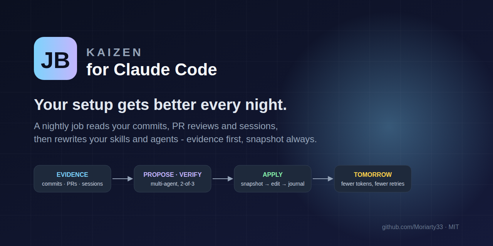
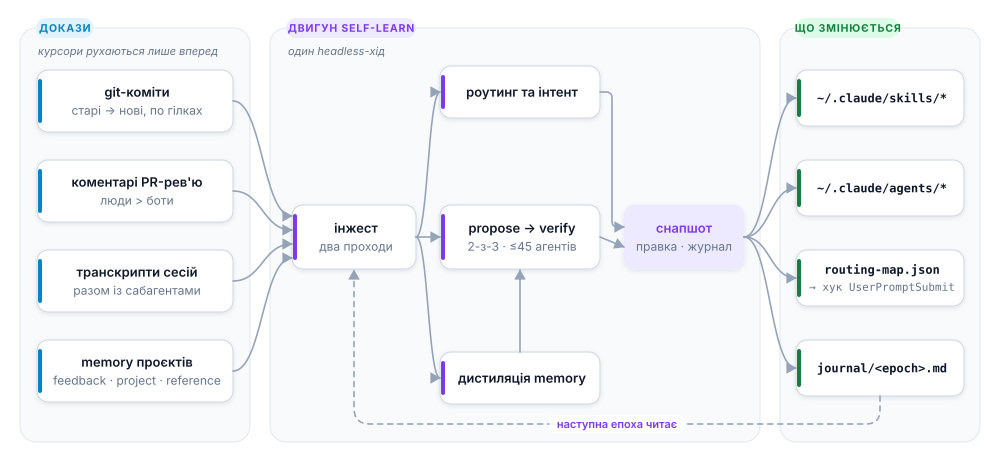
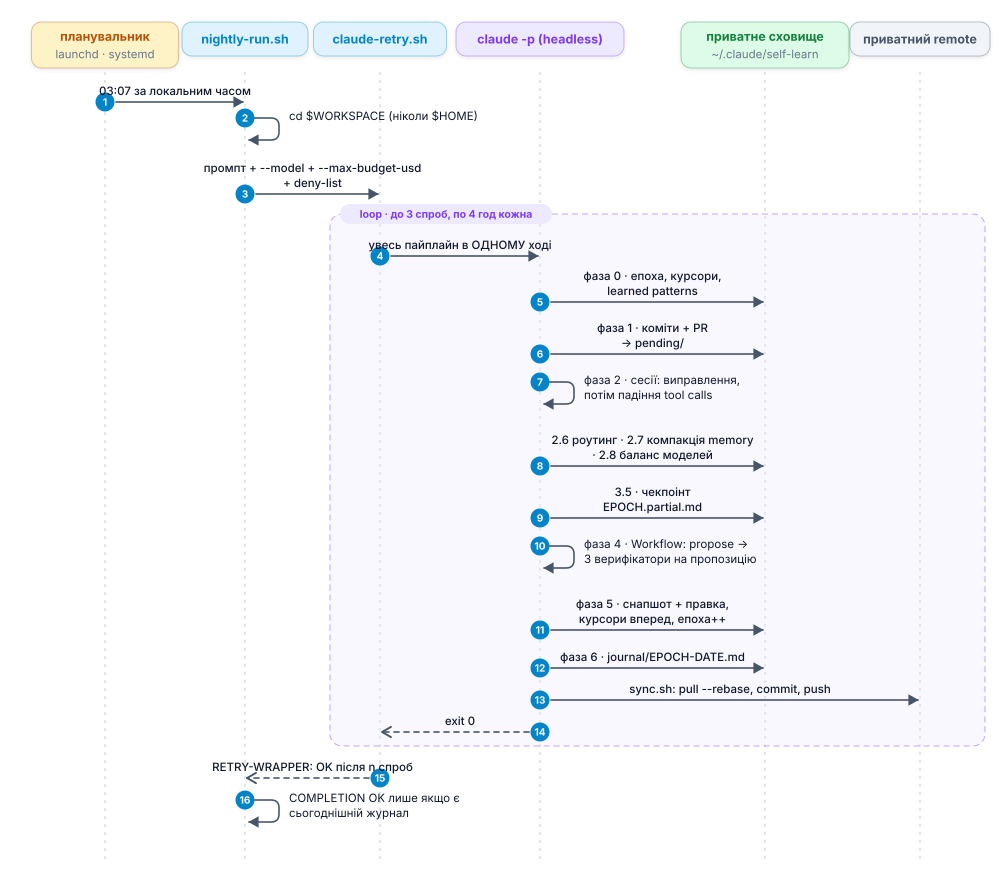

<p align="center">
  
</p>

<h1 align="center">JB Kaizen для Claude Code</h1>

<p align="center"><b>Нічна джоба, яка читає, що ви з Claude реально робили сьогодні, і переписує ваші скіли та агентів так, щоб завтра було менше токенів, менше повторів і менше вашої уваги.</b></p>

<p align="center"><a href="README.md">English README</a></p>

---

Поведінка Claude Code живе у файлах, які належать вам: `~/.claude/skills/*/SKILL.md`, `~/.claude/agents/*.md`,
`CLAUDE.md`, memory проєктів. Вони стають кращими лише тоді, коли ви сідаєте й редагуєте їх - тобто ніколи.
**JB Kaizen** перетворює цю рутину на цикл:

1. **Щоночі** запланований `claude -p` прокидається і читає *нові* докази з минулого разу - git-коміти, коментарі
   з PR-рев'ю, транскрипти сесій, memory проєктів. Уже опрацьовану історію він ніколи не перечитує.
2. **Шукає** в них те, що механічно зламалося (tool calls, які впали і були мовчки обійдені), що ви виправляли,
   що рев'юери відмічають раз за разом, і який скіл ви *мали на увазі*, а Claude вибрав інший.
3. **Мультиагентний propose → adversarial verify** перетворює знахідки на мінімальні правки з посиланням на докази.
   Кожна правка потребує більшості 2-з-3 верифікаторів; усе, що міняє якість на швидкість, відкидається.
4. Кожна правка **знімається в снапшот, версіонується і застосовується**, а журнал пояснює що і чому змінилося.
   Відкат - одна команда.

Через місяць ефект видно: рев'юер перестає пропускати той самий клас багів, роутинг-хук з першого разу відправляє
«подивись в логах чому впало» в правильний скіл, токенів на задачу менше, і ранок іде на роботу, а не на
повторне пояснення того самого.

> Витягнуто з приватного сетапу, де цей цикл крутився **66 епох поспіль** (червень - вересень 2026) по ~70
> репозиторіях. Усе проєктно-специфічне прибрано, усі вистраждані правила двигуна лишилися.

## Як це працює

<picture>
  <source media="(prefers-color-scheme: dark)" srcset="docs/assets/diagrams/how-it-works.uk.dark.svg">
  
</picture>

### Ніч від початку до кінця

<picture>
  <source media="(prefers-color-scheme: dark)" srcset="docs/assets/diagrams/nightly-run.uk.dark.svg">
  
</picture>

### Чому це безпечно лишати без нагляду

- **Двофазні курсори.** `paginate` тільки пропонує батч у `pending/`; курсор рухається лише після успішного
  аналізу. Падіння посеред ночі = той самий батч перечитується, нічого не пропускається.
- **Снапшот перед правкою.** `snapshots/<id>/<version>/` - джерело істини для відкату:
  `/self-learn rollback <id> <version>`.
- **Deny-list на рівні permissions**, не лише в промпті: `~/Documents`, `~/.ssh`, `rm -rf`, force-push.
- **Стеля бюджету** `--max-budget-usd` (єдина, що працює при агентному fan-out) + жорстка стеля 45 агентів,
  вшита лічильником у скрипт, + 4 години на спробу з убивством усієї process group.
- **Propose за замовчуванням.** Інтерактивно нічого не редагується без `apply`; вночі все «гейтоване»
  (реструктуризації, правки багатьох скілів, непідтверджені архівації) іде в журнал на вашу наступну сесію.

### Цикл feedback → скіл

Memory проєкту - найдорожчий вхід: `MEMORY.md` вантажиться в *кожну* сесію. Kaizen трактує кожну feedback-нотатку
як баг-репорт проти скіла: або скіл вивчає правило (мінімальна правка), або доводить, що вже його знає. В обох
випадках нотатка йде в архів з однорядковим вказівником, і `MEMORY.md` худне.

## Встановлення

Потрібно: [Claude Code](https://docs.claude.com/en/docs/claude-code) у `PATH`, `git`, `jq`, `python3`.
Опційно: `gh` (авторизований) для PR-рев'ю, `npx ccusage` для фази балансу моделей.

Усі три шляхи ставлять ті самі сім питань як єдиний крок налаштування: термінальний майстер для
клонування/bootstrap (Enter лишає дефолт) і `/kaizen:kaizen-setup` для плагіна, де у `Bash`-виклику скіла немає TTY.

### 1. Плагін (рекомендовано)

```
/plugin marketplace add Moriarty33/jb-kaizen
/plugin install kaizen@jb-kaizen
/kaizen:kaizen-setup
```

Скіли стають `/kaizen:self-learn`, `/kaizen:model-balance`, `/kaizen:loop-audit` і
`/kaizen:kaizen-setup`,
а хук роутингу приходить разом із плагіном - без правок `settings.json`.

### 2. Одна команда

```bash
curl -fsSL https://raw.githubusercontent.com/Moriarty33/jb-kaizen/main/bootstrap.sh | bash
```

Клонує або оновлює `~/.jb-kaizen` і відкриває той самий майстер.

### 3. Клонування

```bash
git clone https://github.com/Moriarty33/jb-kaizen.git
cd jb-kaizen
./install.sh                                  # майстер налаштування: сім питань, Enter лишає дефолт
```

Кожен крок спершу пояснює, для чого він:

| Крок | Питає | Навіщо |
|------|-------|--------|
| 1 Залежності | поставити те, чого бракує (`gh`, `node`, `uv`, `graphify`, `code`...) | кожен інструмент пояснює себе; обов'язкові лише `git`, `jq`, `python3` |
| 2 Корені | де лежать ваші git-репозиторії | одна або кілька тек; нові репо під ними підхоплюються самі |
| 3 Репозиторії | які зі знайдених вивчати | будь-який можна вимкнути; у проєкти нічого не пишеться |
| 4 Хук роутингу | ставити підказку `UserPromptSubmit` | один рядок, коли збігається вивчена фраза; інакше тиша |
| 5 Нічний запуск | запускати щоночі і о котрій | launchd / systemd --user / рядок для crontab |
| 6 Приватний remote | бекапити сховище | там назви і шляхи проєктів: лише приватні репозиторії |
| 7 VS Code | `claude-launcher`, `graphify-watch` | див. [Компаньйони для редактора](#компаньйони-для-редактора) |

Відповіді зберігаються в `~/.claude/self-learn/config.json`, тож оновлення та інші машини проходять тихо
(поза терміналом майстер не питає нічого). `./install.sh --wizard` відкриває питання знову; прапорці пропускають
їх для скриптового встановлення і запам'ятовуються: `--workspace DIRS`, `--schedule [HH:MM]`, `--store-remote URL`,
`--hook/--no-hook`, `--vscode LIST`, `--plugin`, `--yes`. `--plugin` - для плагінного встановлення, що
неінтерактивно завершує налаштування: пропускає те, що плагін уже приніс сам (копію скілів, реєстрацію хука).

Спершу спробуйте інтерактивно - у цьому режимі нічого не редагується:

```text
claude
> /self-learn status      # епоха 0, що відстежується
> /self-learn             # повний прохід, лише пропозиції з поясненнями
> /self-learn apply       # те саме, але снапшот + застосування
```

Потім - на ніч:

```bash
./install.sh --schedule 03:07                                   # launchd на macOS, systemd --user на Linux
./install.sh --store-remote git@github.com:you/kaizen-store.git  # бекап сховища в ПРИВАТНИЙ репозиторій
```

`./install.sh --help` - усі прапорці; `./uninstall.sh` прибирає все (сховище лишається, якщо не `--purge-store`).
Плагінне встановлення: спершу зніміть нічну джобу - `ROOT="$(ls -td "${CLAUDE_CONFIG_DIR:-$HOME/.claude}"/plugins/cache/*/kaizen/*/ | head -1)"; bash "$ROOT/uninstall.sh"` (з `--purge-store` - і сховище), потім `/plugin uninstall kaizen@jb-kaizen`.

## Що і куди ставиться

| Шлях | Що |
|------|----|
| `~/.claude/plugins/cache/<marketplace>/kaizen/<version>/` | **плагінне встановлення**: скіли, `hooks/hooks.json`, `install.sh`, `uninstall.sh` - замість рядків `~/.claude/skills/*` нижче. `lib/skill-dir.sh` резолвить найновішу закешовану версію за mtime теки, а не за номером версії, тож старий залишок після `/plugin update` ніколи не переможе |
| `~/.claude/skills/self-learn/` | шлях клонування/bootstrap: двигун - `SKILL.md`, 14 bash-скриптів, довідники (workflow, роутинг-рубрика, learned patterns) |
| `~/.claude/skills/model-balance/` | шлях клонування/bootstrap: аудит моделі × зусилля з даних `ccusage` (фаза 2.8, опційно) |
| `~/.claude/skills/loop-audit/` | шлях клонування/bootstrap: контракт із 6 частин + три запобіжники для будь-якого автономного циклу |
| `~/.claude/hooks/skill-router.py` | шлях клонування/bootstrap: хук `UserPromptSubmit`, один рядок підказки, коли збігається вивчена фраза; інакше тиша - плагін приносить цей хук сам, див. рядок вище |
| `~/.claude/lib/claude-retry.sh` | обмежені ретраї, бюджет часу, kill усієї process group, стоп на auth-помилці |
| `~/.claude/lib/skill-dir.sh` | резолвить теку скіла на диску для обох варіантів - клонування/bootstrap і плагіна; підключається нічним раннером і скриптами скілів |
| `~/.claude/night-guard-settings.json` | deny-list для нічного запуску |
| `~/.claude/self-learn/` | **приватне сховище**: курсори, реєстр, версії, снапшоти, роутинг-мапа, журнал, нічна джоба |
| `~/.claude/self-learn/config.json` | ваші відповіді майстру: корені, вимкнені репо, хук, розклад, remote, вибір VS Code |
| `~/.vscode/extensions/local.claude-launcher-*` | опційно: кнопка-ракета, що відкриває `claude` у корені вікна |
| `~/.vscode/extensions/local.graphify-watch-*` | опційно: тримає graphify-граф відкритої теки актуальним |

## Компаньйони для редактора

У `vscode/` лежать два невеликі розширення VS Code (MIT, сирці плюс зібраний `.vsix`; ставляться через CLI `code`
кроком 7 майстра або `vscode/install-vscode.sh`). Обидва опційні, двигун від них не залежить.

- **claude-launcher** додає кнопку-ракету в заголовок редактора. Один клік відкриває термінал у корені вікна
  (тека або директорія з `.code-workspace`) і запускає `claude --permission-mode auto`. Кожен проєкт на один клік
  від сесії, тож більше вашої роботи потрапляє у транскрипти, з яких вчиться двигун.
- **graphify-watch** тримає актуальним граф знань [graphify](https://pypi.org/project/graphifyy/) відкритої теки:
  нативний file watching VS Code, дебаунс і одноразовий `graphify update` на зміни коду, стан у status bar,
  захист від усадки графа з одним автоматичним `--force`, і lock, щоб два вікна не перебудовували одночасно.
  З актуальним графом агенти відповідають «як X пов'язано з Y» зі звуженого підграфа, а не grep-ом по дереву.
  Потребує `graphify`; крок 1 майстра ставить його через `uv tool install graphifyy` і додає скіл `/graphify`.

**Нові проєкти** не потребують налаштування: кожен запуск пересканує корені,
`scripts/register.sh <path>` з резолвленої теки скіла (див. `lib/skill-dir.sh`) реєструє репо одразу
після `git init`, а `./install.sh --wizard` вимикає будь-який.

## Як виглядає одна ніч

Справжній журнал (назви проєктів прибрано), епоха 66 приватної лінії:

> **8 правок застосовано.** 0 із 33 вердиктів проголосували «keep» як запропоновано - усі 33 дали *correction*,
> тож кожен відвантажений рядок - це звужений текст верифікатора. Два класи ЗАКРИТО з цифрами і без правок.
>
> **Покриття:** 92 нових коміти / 9 репо · 47 PR / 416 коментарів / 173 людських · 1 312 транскриптів ·
> 217 файлів memory · 38 агентів / 1,37M токенів / 0 помилок / 527 с при стелі 45.
>
> **Закрито з цифрами:** «користувач постійно просить коротший вивід» - 129 збігів regex, ~123 з них - текст
> скілів, відлунений у user-записи; справжніх запитів ≈ 6 у 4 сесіях. Це не правило.

Останній абзац і є суть: двигун витрачає стільки ж зусиль на *спростування* власних знахідок, скільки на їх пошук.

## Конфігурація

| Де | Що |
|----|----|
| `registry.json` | `repos[key].enabled`, `repos[key].config.{batch,maxTotal,botLogins}`, глобальний `botLogins` |
| `nightly-prompt.txt` | контракт запуску: скоуп, фази, бюджет |
| `scripts/nightly-run.sh` | `SELF_LEARN_MODEL`, `SELF_LEARN_BUDGET_USD`, `CLAUDE_RETRY_TIMEOUT`, `SELF_LEARN_WORKSPACE` |
| `routing/routing-map.json` | вивчені фрази для хука (будь-якою мовою, разом із помилками диктування) |

## Автор

**Богдан Ямінський** - engineering manager, будує агентні workflow, які самі себе окуповують.
GitHub [@Moriarty33](https://github.com/Moriarty33) · LinkedIn [bogdan-jaminski](https://www.linkedin.com/in/bogdan-jaminski/)

MIT © 2026 Bogdan Jaminski
