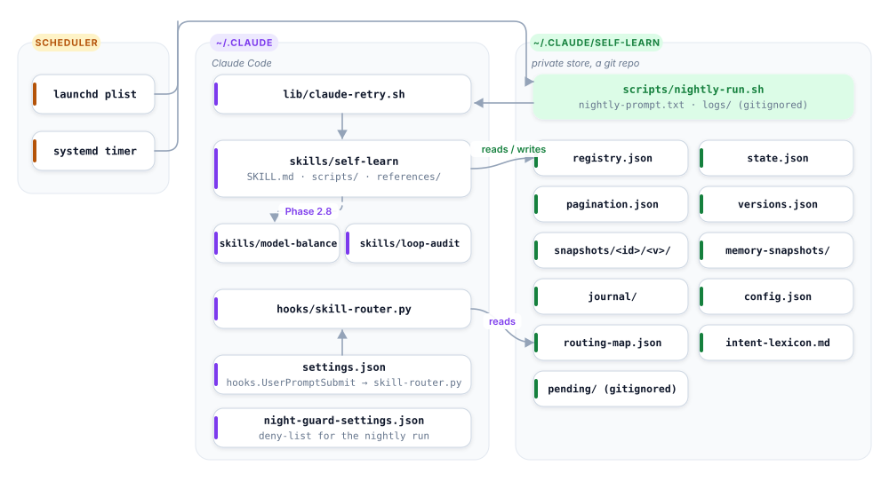
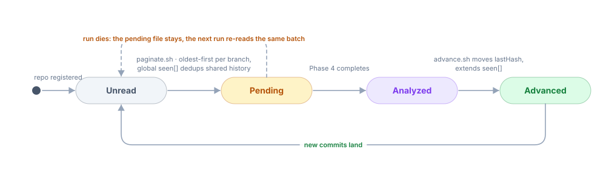

# Architecture

## Components

<picture>
  <source media="(prefers-color-scheme: dark)" srcset="../docs/assets/diagrams/components.dark.svg">
  
</picture>

## Plugin layout

Two install modes deliver the same engine:

- **Plugin** - `.claude-plugin/plugin.json` (the plugin itself) and `.claude-plugin/marketplace.json`
  (the one-plugin marketplace that points at it) are the manifest pair `claude plugin validate` and
  CI check. `skills/` and `hooks/hooks.json` are auto-discovered by Claude Code from the plugin root -
  no registration step. The hook command in `hooks/hooks.json` runs
  `python3 "${CLAUDE_PLUGIN_ROOT}/hooks/skill-router.py"`, so it resolves against wherever the plugin
  cache placed this version rather than a fixed path. First-run configuration is the `/kaizen:setup`
  skill: a non-interactive wizard, needed because a skill's `Bash` call has no TTY for the terminal one.
- **Clone / bootstrap** - `git clone` + `./install.sh`, or the one-line `bootstrap.sh` that does the
  same and opens the wizard, copy the skills under `~/.claude/skills/*` and register the hook in
  `~/.claude/settings.json` by hand.
- **Short aliases** - `templates/aliases/kz-{setup,learn,audit,balance}/SKILL.md` are installed into
  `~/.claude/skills/` by `install.sh` in both modes (`--no-aliases` opts out). Claude Code has no
  `alias` field and a plugin skill is always `/<plugin>:<skill>`, so each is a personal forwarder
  skill that resolves its target with `sl_skill_dir` and follows that `SKILL.md`;
  `disable-model-invocation: true` keeps them out of automatic triggering. `lib/install-aliases.sh`
  owns the list, the install and the removal.

`install.sh --plugin` is the seam between them: it runs the same wizard and writes the same
`config.json`, but skips the skills copy and the hook registration, because the plugin already
delivered both - re-doing either would create a duplicate skill tree or a duplicate `skill-router`
entry in `settings.json`.

Both modes resolve "which skill directory is this?" through the one rule in `lib/skill-dir.sh`
(`sl_skill_dir`): prefer `$SELF_LEARN_SKILL_DIR` when it is set and is a directory (the `self-learn`
skill only), then `${CLAUDE_CONFIG_DIR:-~/.claude}/skills/<name>` (the clone/bootstrap path), then the
newest `${CLAUDE_CONFIG_DIR:-~/.claude}/plugins/cache/*/kaizen/*/skills/<name>` by directory mtime
(the plugin path, picking the freshest cached version rather than trusting a version string). The
nightly runner and the skill scripts source this helper instead of hardcoding either path, so the
same job works unmodified under either install mode.

## Data model

| File | Owner | Shape |
|------|-------|-------|
| `registry.json` | `discover.sh`, `register.sh` | `{roots[], botLogins[], repos{key: {name,path,remote,enabled,config{batch,maxTotal,botLogins}}}}` - `key` is the origin URL when present, else the path, so one repo cloned twice shares a cursor |
| `state.json` | `state.sh` | `{epoch, version, createdAt, lastRunAt}` |
| `config.json` | `install.sh` (wizard) | `{version, roots[], disabledRepos[], hook, schedule{enabled,time}, storeRemote, vscode{claudeLauncher,graphifyWatch}, installedVersion, updatedAt}` - the install answers; every run resolves flags > config > defaults and writes the result back |
| `pagination.json` | `advance.sh`, `pr-advance.sh`, `sessions.sh`, `memory.sh` | `repos{key: {branches{b:{lastHash}}, seen[], prs{cursor, openSeen{n: updatedAt}}}}`, `sessions{encodedDir: {lastTs}}`, `memory{dir: {files{name: hash}}}` |
| `versions.json` | `snapshot.sh` | `items{id: {version, hash, path, snapshot, history[]}}` |
| `pending/<repo>.json` | `paginate.sh` | proposed commit batch, consumed by `advance.sh` |
| `pending/pr-<repo>.json` | `pr-paginate.sh` | proposed PR batch with full comment bodies, consumed by `pr-advance.sh` |

Item ids: `global:agent:<name>`, `global:skill:<name>`, `project:<repo>:agent:<name>`, `project:<repo>:skill:<name>`.
Snapshot directories replace `:` and `/` with `_`.

## Cursor semantics

<picture>
  <source media="(prefers-color-scheme: dark)" srcset="../docs/assets/diagrams/cursor-states.dark.svg">
  
</picture>

Three independent cursor families share the same discipline: commits (per branch), PRs (historical number
cursor + per-open-PR `updatedAt`), sessions (per project directory mtime), memory (per directory file hashes).
None moves until Phase 5.

## The seven phases

| Phase | Reads | Writes | Script |
|-------|-------|--------|--------|
| 0 Orient | `learned-patterns.md`, `state.sh status`, `journal/*.partial.md` | - | `state.sh` |
| 1 Commits | registry, git log | `pending/<repo>.json` | `discover.sh`, `paginate.sh` |
| 1b PRs | GitHub API via `gh` | `pending/pr-<repo>.json` | `pr-paginate.sh` |
| 2 Sessions | `~/.claude/projects/**/*.jsonl` | corpus list in `/tmp` | `sessions.sh`, `corpus.sh` |
| 2.6 Routing | transcripts | `routing/*` | (model) + `skill-router.py` verify |
| 2.7 Memory | `~/.claude/projects/*/memory/` | archive/, `MEMORY.md`, `memory-snapshots/` | `memory.sh` |
| 2.8 Models | job scripts, skill frontmatter, `ccusage` | single-site config edits + journal | `model-balance` |
| 3 Inventory | agents + skills on disk | - | `inventory.sh` |
| 3.5 Checkpoint | everything above | `journal/<epoch>.partial.md` | - |
| 4 Analysis | candidates + learnings | proposals (in memory) | Workflow from `analysis-workflow.md` |
| 5 Apply | confirmed proposals | `snapshots/`, live files, cursors, epoch | `snapshot.sh`, `advance.sh`, `pr-advance.sh`, `sessions.sh --advance`, `memory.sh advance`, `state.sh bump-epoch` |
| 6 Journal | - | `journal/<epoch>-<date>.md`, `learned-patterns.md`, remote | `sync.sh` |

## The analysis workflow

`references/analysis-workflow.md` ships a ready-to-adapt script for the Claude Code `Workflow` tool:

- one **propose** agent per candidate (read-only `Explore` type - it cannot touch files);
- **three verify** agents per proposal, each told to refute it and to default to reject;
- a **budget counter** in the script caps the whole phase at 45 agents;
- required output slots (`nearestExistingText`, `oldText`) that force the proposer to quote what it found,
  so a verifier can check the delta byte-for-byte;
- a `correction` slot so a verifier can narrow an over-broad rule instead of rejecting it outright.

The main skill then adjudicates every confirmed proposal against its evidence before snapshotting - the
majority is a filter, not an autopilot.

## Runtime safety envelope

| Layer | Mechanism |
|-------|-----------|
| Process | `claude-retry.sh`: `set -m` process group, poll against `CLAUDE_RETRY_TIMEOUT`, TERM then KILL the group, ≤3 attempts with backoff, auth errors not retried |
| Spend | `--max-budget-usd` on the `claude -p` call; 45-agent counter inside Phase 4 |
| Filesystem | `night-guard-settings.json` deny rules (`Read(...)`/`Edit(...)` are the kinds the permission checker matches); cwd forced to the workspace; sessions with an out-of-scope cwd skipped |
| Data | two-phase cursors; snapshot-before-edit; `sl_atomic_write` refuses to write empty/invalid JSON over a cursor file; `pr-paginate.sh` aborts loudly on an unread stream instead of advancing past it |
| Completion | `nightly-run.sh` reports `COMPLETION OK` only when today's journal exists; `.partial.md` deliberately does not match |
